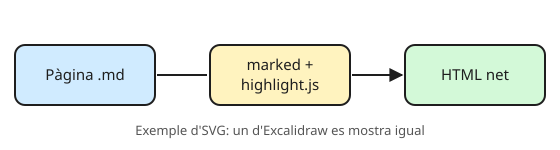

# Imatges i Excalidraw

Les imatges de cada tema van a la seva carpeta `img/`. A l'editor, el botó d'imatge, **enganxar** (Ctrl+V d'una captura) o **arrossegar** un arxiu la desa allà i n'escriu l'enllaç.

## Diagrames amb Excalidraw

1. Dibuixa a [excalidraw.com](https://excalidraw.com).
2. **Export image → SVG**, amb l'opció **Embed scene** activada.
3. Afegeix l'SVG a la pàgina (botó d'imatge o arrossegant-lo).

Amb *Embed scene*, l'SVG porta el dibuix dins: per modificar-lo, obre'l a excalidraw.com, canvia'l i torna'l a exportar amb el mateix nom. La pàgina mostra la versió nova sola.

> En tema fosc, els SVG es mostren sobre un fons clar perquè les línies fosques es vegin.
