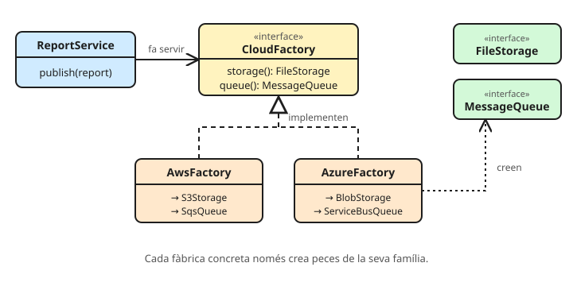

# Abstract Factory

**Proporciona una interfície per crear famílies d'objectes relacionats sense dir quines classes concretes són.** Qui la fa servir demana «un emmagatzematge» i «una cua», i rep peces que encaixen entre elles.

Font per ampliar: [Abstract Factory a refactoring.guru](https://refactoring.guru/design-patterns/abstract-factory).

## El problema

Una aplicació que pot funcionar a AWS o a Azure. Cada proveïdor té el seu emmagatzematge de fitxers i la seva cua de missatges, i **no es poden barrejar** (un fitxer a S3 amb un avís per Azure Service Bus no té sentit):

```java
public class ReportService {
    public void publish(Report report, String cloud) {
        if ("AWS".equals(cloud)) {
            new S3Storage().upload(report.file());
            new SqsQueue().send("report-ready");
        } else if ("AZURE".equals(cloud)) {
            new BlobStorage().upload(report.file());
            new ServiceBusQueue().send("report-ready");
        }
        // un proveïdor nou = tocar tots els llocs on hi ha aquest if
    }
}
```

**Els senyals (code smells):**

- El mateix `if (cloud == ...)` repetit a molts llocs, cada vegada creant objectes diferents.
- Res impedeix barrejar peces de famílies diferents per error.

## La solució



1. Una interfície per a cada **producte**: `FileStorage`, `MessageQueue`.
2. Una interfície de **fàbrica** amb un mètode per producte.
3. Una fàbrica concreta per **família**, que només crea peces de la seva família.

```java
// Productes
public interface FileStorage { void upload(Path file); }
public interface MessageQueue { void send(String message); }

// La fàbrica abstracta: una família sencera
public interface CloudFactory {
    FileStorage storage();
    MessageQueue queue();
}

// Una fàbrica concreta per família
public final class AwsFactory implements CloudFactory {
    public FileStorage storage() { return new S3Storage(); }
    public MessageQueue queue() { return new SqsQueue(); }
}

public final class AzureFactory implements CloudFactory {
    public FileStorage storage() { return new BlobStorage(); }
    public MessageQueue queue() { return new ServiceBusQueue(); }
}
```

El client només coneix les interfícies:

```java
public class ReportService {
    private final FileStorage storage;
    private final MessageQueue queue;

    public ReportService(CloudFactory cloud) {
        this.storage = cloud.storage(); // les dues peces són de la mateixa família
        this.queue = cloud.queue();
    }

    public void publish(Report report) {
        storage.upload(report.file());
        queue.send("report-ready");
    }
}
```

La família es tria **un sol cop**, en arrencar (per configuració):

```java
CloudFactory cloud = switch (config.cloud()) {
    case "AWS" -> new AwsFactory();
    case "AZURE" -> new AzureFactory();
    default -> throw new IllegalArgumentException("Proveïdor desconegut: " + config.cloud());
};
ReportService service = new ReportService(cloud);
```

Afegir Google Cloud és afegir `GcpFactory` i els seus productes, **sense tocar `ReportService`**.

## Abstract Factory vs Factory Method

| | Factory Method | Abstract Factory |
| --- | --- | --- |
| Què crea | **Un** producte | Una **família** de productes relacionats |
| Com | Una subclasse decideix quina classe instancia | Un objecte fàbrica amb un mètode per producte |
| Relació | Herència | Composició (es passa la fàbrica) |

Sovint una Abstract Factory està feta de diversos Factory Method: cada mètode (`storage()`, `queue()`) n'és un.

## On el veus

- **JDBC**: una `Connection` crea `Statement`, `PreparedStatement` i `CallableStatement`, i tots són del mateix driver (MySQL, H2…). No pots fer servir un `PreparedStatement` de MySQL amb una connexió d'H2.
- **`javax.xml.parsers.DocumentBuilderFactory`** i **`TransformerFactory`**: el codi treballa amb les interfícies i la implementació concreta es tria en temps d'execució.
- **A Spring**: amb perfils (`@Profile("aws")` / `@Profile("azure")`), una classe de configuració per família fa el paper de fàbrica concreta, i Spring injecta les peces que toquen.

## Quan NO

- Si només hi ha **una família** i no se n'espera cap altra: és complexitat de més.
- Si els productes **no estan relacionats** (no cal que «encaixin»): n'hi ha prou amb un Factory Method o amb injectar cada peça per separat.
- Inconvenient: afegir un **producte nou** a la família (per exemple, `Database`) obliga a tocar la interfície i **totes** les fàbriques concretes.

## Preguntes de repàs

<details>
<summary>Quin problema resol que no resolgui injectar <code>FileStorage</code> i <code>MessageQueue</code> per separat?</summary>

Garanteix la **coherència de la família**: amb una sola fàbrica és impossible combinar S3 amb Service Bus. Injectant-les per separat, una configuració equivocada les podria barrejar.
</details>

<details>
<summary>Què és més fàcil d'afegir: una família nova o un producte nou?</summary>

Una **família nova** (una classe de fàbrica i els seus productes, sense tocar res). Un **producte nou** obliga a canviar la interfície de la fàbrica i totes les implementacions: és el preu del patró.
</details>

<details>
<summary>Quin principi SOLID fa complir el client que només coneix <code>CloudFactory</code>?</summary>

La **inversió de dependències** (D): `ReportService` depèn d'abstraccions, no d'`AwsFactory` ni de `S3Storage`. I també l'**Open/Closed** per a famílies noves. Vegeu [Principis SOLID](../../01%20Fonaments/01%20Principis%20SOLID.md).
</details>
