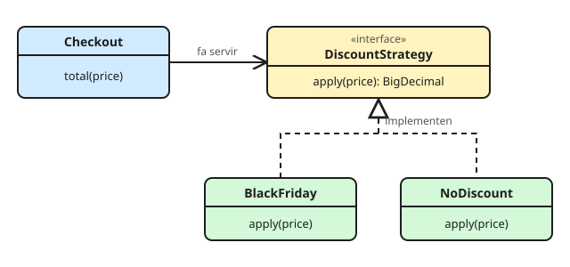

# Strategy

**Defineix una família d'algorismes, encapsula cadascun i fes-los intercanviables.** Qui els fa servir no sap quin té: només coneix la interfície.

## El problema

Un càlcul que canvia segons el cas, resolt amb condicionals:

```java
public BigDecimal finalPrice(BigDecimal price, String campaign) {
    if ("BLACK_FRIDAY".equals(campaign)) {
        return price.multiply(new BigDecimal("0.70"));
    } else if ("SUMMER".equals(campaign)) {
        return price.multiply(new BigDecimal("0.85"));
    }
    return price; // cada campanya nova = tocar aquest mètode
}
```

**El senyal (code smell):** un `if`/`switch` sobre un tipus que creix cada vegada que hi ha un cas nou, i que sovint es repeteix en altres llocs.

## La solució



```java
public interface DiscountStrategy {
    BigDecimal apply(BigDecimal price);
}

public final class BlackFriday implements DiscountStrategy {
    public BigDecimal apply(BigDecimal price) {
        return price.multiply(new BigDecimal("0.70"));
    }
}

public final class NoDiscount implements DiscountStrategy {
    public BigDecimal apply(BigDecimal price) {
        return price;
    }
}

public class Checkout {
    private final DiscountStrategy discount;

    public Checkout(DiscountStrategy discount) {
        this.discount = discount;
    }

    public BigDecimal total(BigDecimal price) {
        return discount.apply(price); // no sap quina estratègia és
    }
}
```

Afegir una campanya és **afegir una classe**, sense tocar `Checkout` (principi [Open/Closed](../../01%20Fonaments/01%20Principis%20SOLID.md)).

### Amb lambdes

Si l'estratègia és una sola funció, una interfície funcional n'hi ha prou:

```java
Checkout summer = new Checkout(price -> price.multiply(new BigDecimal("0.85")));
```

## On el veus cada dia

- `Comparator<T>` a `list.sort(comparator)`: l'ordre és l'estratègia.
- A Spring, injectar una interfície amb diverses implementacions (`Map<String, PaymentProvider>` o `@Qualifier`).
- `ThreadPoolExecutor` rep un `RejectedExecutionHandler` per decidir què fer quan la cua és plena.

## Quan NO

- Si només hi ha dos casos i no n'hi haurà més: un `if` és més clar.
- Si les «estratègies» necessiten conèixer massa detalls de qui les fa servir, la frontera està mal posada.

## Preguntes de repàs

<details>
<summary>Quina diferència hi ha entre Strategy i State?</summary>

L'estructura és gairebé igual. A **Strategy**, qui fa servir l'objecte tria l'algorisme des de fora. A **State**, l'objecte canvia d'estat ell mateix i, amb l'estat, de comportament.
</details>

<details>
<summary>On hi hauria un Strategy al bot de MagDo?</summary>

En la política per triar quina runa posar (per exemple, «prioritza l'stat més lluny del mínim» o «prioritza el que té més pes»), i en la configuració de les caselles per a cada resolució.
</details>
